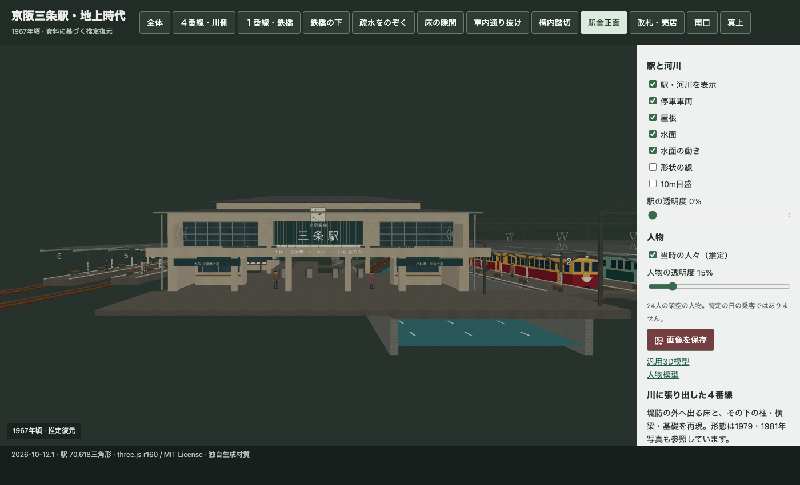
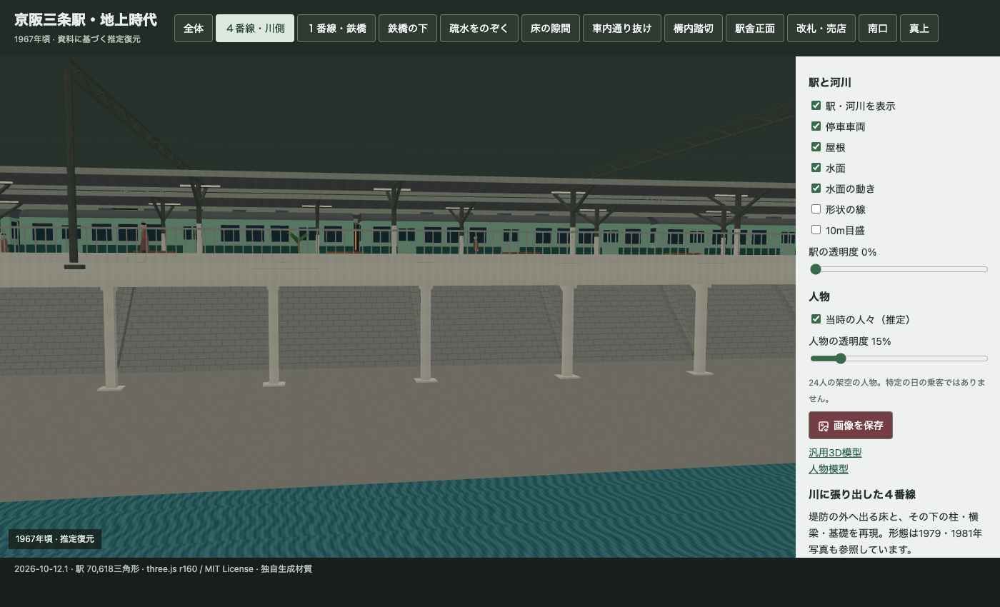
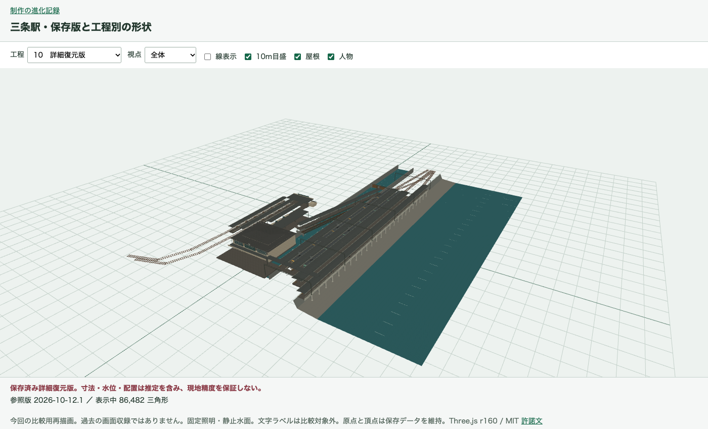
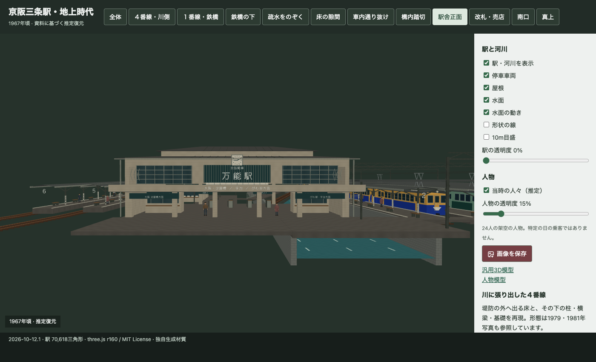
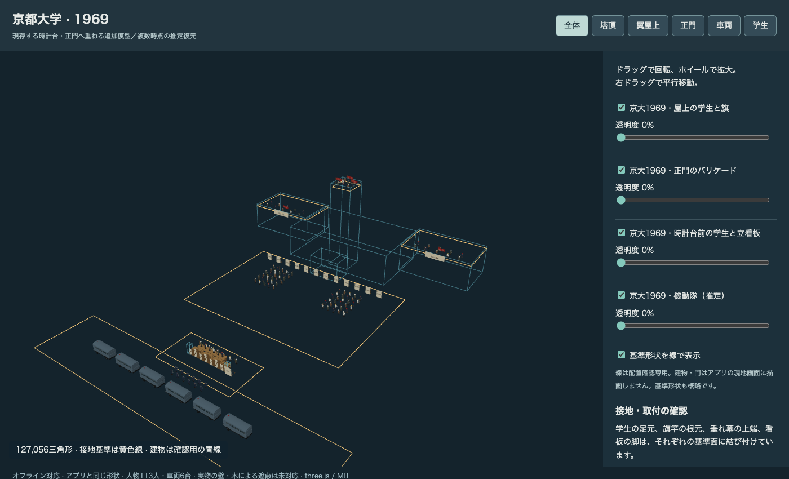

# SD202612 — かつて存在した景色や人を、今の世界に置いて見る

『Software Design』誌 連載「万能IT技術研究所」第55回（2026年12月号）
「かつて存在した景色や人を、今の世界に置いて見る ―― 画像を理解するAIで、情報や画像から3Dモデルを生成する」のサポートファイルです。

記事では、1987年に地下へ潜った京阪電車の三条駅（京都）を、画像を理解するAI（OpenAI の GPT-6 Astra）に
3Dモデルとして復元させ、スマホのカメラ映像に重ねて眺めました。
ここには、**AIが書いたPythonコードそのもの**と、**それが生成した1967年頃の三条駅の3Dモデル**が入っています。
特別な機材は要りません。ブラウザだけで、消えた地上駅の中を歩けます。

**すぐに見る → https://mong-kok.github.io/SD202612/** （PC でもスマホでも、リンクを開くだけです）



## できること

| 遊び方 | 要るもの | かかる時間 |
|---|---|---|
| 1. 1967年頃の三条駅を歩く（12の視点、電車の中も通り抜けられます） | ブラウザ | 1分 |
| 2. AIが駅を作っていった過程を、12の工程で見比べる | ブラウザ | 3分 |
| 3. AIが書いたコードを走らせて、同じ駅を自分のPCで生成する | Python 3（追加ライブラリなし） | 約10秒 |
| 4. コードを1行書き換えて、自分の駅にする（記事の「眺めて直す」を体験） | Python 3 とテキストエディタ | 5分〜 |
| 5. 1969年の京都大学・時計台の学生たちを眺める | ブラウザ | 1分 |

- APIキーなし・登録なし・インターネット接続なしで動きます（資料へのリンクを開くときだけ接続が要ります）
- 記事の最後に出てくる「現地でスマホをかざして重ねる」体験は、iPhone用の自作アプリが必要なので、ここには含めていません。
  その代わりに、アプリが読み込むのと同じ3Dモデルを、ブラウザで見られるようにしてあります

## 1. 1967年頃の三条駅を歩く

いちばん手軽なのは https://mong-kok.github.io/SD202612/ から「三条駅を開く」を押す方法です。
手元に置いて見るときは、`三条駅3Dビューア/三条駅1967_3Dビューア.html` をブラウザで開いてください（ダブルクリックで開きます）。

```bash
git clone https://github.com/Mong-Kok/SD202612.git
cd SD202612
open 三条駅3Dビューア/三条駅1967_3Dビューア.html      # macOS の場合
```

| 操作 | 動き |
|---|---|
| ドラッグ | 回転 |
| スクロール（ピンチ） | 拡大・縮小 |
| 右ドラッグ | 平行移動 |
| 上部のボタン | 「駅舎正面」「４番線・川側」「鉄橋の下」「車内通り抜け」など12の視点へ移動 |
| 右側のチェック | 駅・電車・屋根・水面・人物の表示切り替え、透明度、10m目盛 |
| 「画像を保存」 | いま見えている眺めをPNG画像に保存 |

おすすめは「４番線・川側」です。鴨川へ張り出したホームと、それを支える柱の列を、川べりから見上げられます。



同じフォルダの `sanjo1967.glb`（駅と電車）と `people1967.glb`（人物）は、Blender などの3Dソフトで開ける汎用形式のファイルです。

## 2. AIが駅を作っていった過程を見比べる

`進化の比較/model-comparison.html` をブラウザで開き（または https://mong-kok.github.io/SD202612/ の「工程の比較を開く」）、左上の「工程」を切り替えてください。
何もない状態から、駅舎の床、壁、単色の初版、色と材質、電車、人物、川側のホーム、疏水と鉄橋、と進んでいきます。
視点を固定したまま工程だけを切り替えると、AIがどこを直したかが分かります（記事の図4）。



## 3. AIが書いたコードで、同じ駅を生成する

`model/Tools/` の5本が、AIが書いたPythonです。標準ライブラリだけで動きます。

```bash
python3 model/Tools/prepare_sanjo_station.py   # 駅・電車・人物の3Dモデルを生成（約10秒）
python3 model/Tools/prepare_sanjo_viewer.py    # それを内包したビューアのHTMLを生成（約1秒）
```

1行目が `station triangles 70618 people 24 people triangles 15864` と表示すれば成功です。
`三条駅3Dビューア/` の中身が作り直されます。何も書き換えていなければ、配布しているファイルと1バイトも違わないものができます。

| ファイル | 中身 |
|---|---|
| `prepare_sanjo_station.py` | 直方体・梁・寄棟屋根・ホーム・線路を作る関数と、それに寸法を渡して駅を組み立てる本体。3Dモデルのファイル（GLB）も自前で書き出す |
| `sanjo_detail.py` | 川へ張り出した４番線、疏水、斜めの鉄橋などの細部 |
| `sanjo_figures.py` | 2形式の電車と、24人の架空の人物 |
| `sanjo_materials.py` | 色の一覧（`PALETTE`）と、屋根・砂利・水面などの模様を乱数で作る処理（写真の切り貼りではありません） |
| `prepare_sanjo_viewer.py` | ブラウザ用ビューアの生成 |

生成の途中でできる `model/Resources/Sanjo1967/model.json` には、原点の緯度・経度・高さ、参考にした資料、
部材ごとの「何を根拠にしたか・どの程度確かか」が入っています。AIが何を見てどう判断したのかを追うときの手がかりになります。

## 4. コードを書き換えて、自分の駅にする

記事で説明したとおり、このAIは「描画を眺めて、気づいたことを言葉にして、コードを書き換えて、また描画する」を繰り返して駅を作りました。
同じことを自分でやってみましょう。書き換えたら、上の2つのコマンドをもう一度走らせて、ビューアを再読み込みします。

| やってみること | 書き換える場所 | 例 |
|---|---|---|
| 電車の色を変える | `sanjo_materials.py` の `PALETTE` にある `'train_red':(137,30,43)` | `(30,60,160)` にすると、赤い帯が青になります |
| 駅名の看板を変える | `prepare_sanjo_station.py` の `label('三 条 駅',…)` | `'万 能 駅'` など |
| ホームの柱を増やす | `prepare_sanjo_station.py` の `for yy in range(int(ys+4),int(yn),8):` の `8`（柱の間隔、メートル） | `4` にすると柱が倍になります |
| 駅舎の屋根を高くする | `prepare_sanjo_station.py` の `hiproof(0,-11.3,29.0,24.5,7.12,8.2)` の最後の2つ（軒と棟の高さ、メートル） | `7.12,11.0` |

上の2つを書き換えた結果がこちらです。



AIと同じように「画像を保存して眺める」ところまで機械にやらせたいときは、画面を出さないブラウザで描画を保存できます（macOS と Google Chrome の例）。

```bash
"/Applications/Google Chrome.app/Contents/MacOS/Google Chrome" --headless=new \
  --use-angle=swiftshader --enable-unsafe-swiftshader --window-size=1400,850 \
  --virtual-time-budget=8000 --screenshot=shot.png \
  "file://$PWD/三条駅3Dビューア/三条駅1967_3Dビューア.html"
```

手元にコードを書けるAIエージェントがあれば、このフォルダを渡して「ホームにベンチを増やして」「駅前に街灯を立てて」と頼み、
保存した画像を見せて直させてみてください。記事の図5の輪を、自分の机の上で回せます。

## 5. 1969年の京都大学・時計台の学生たちを眺める

`京都大学1969_3Dビューア/京都大学1969_3Dビューア.html` をブラウザで開いてください（または https://mong-kok.github.io/SD202612/ の「京都大学を開く」）。
記事の最後で時計台に重ねた、学生・旗・立看板・バリケードの3Dモデルです。
現存する時計台と正門に重ねるための追加モデルなので、建物そのものは位置合わせ用の線だけで描いています。



## 記事との対応

| 記事 | このリポジトリ |
|---|---|
| 図1 AIが復元した1967年頃の京阪三条駅 | `三条駅3Dビューア/`（遊び方1） |
| 図2 AIが三条駅を組み立てた6つの処理 | 処理4・5・6 が `model/Tools/`（遊び方3） |
| 図3 AIが書いた形状生成関数と、駅舎を組み立てるコード | `model/Tools/prepare_sanjo_station.py` の `box`・`beam`・`hiproof` と、その下の駅舎の組み立て |
| 図4 3Dモデルの4つの保存版 | `進化の比較/`（遊び方2） |
| 図5 作る・描かせる・眺める・直す | 遊び方4 |
| 本文「東・北・高さのメートル座標」 | `model.json` の `anchor`（原点の緯度・経度・標高・ジオイド高・楕円体高）と `localAxes` |
| 図6・図7 現地の映像に重ねた眺め | 同じ3Dモデルを遊び方1・5 のビューアで |

## 知っておいてほしいこと

- これは資料にもとづく**推定復元**です。測量図や施工図から起こしたものではありません。寸法・床の高さ・細部には推定が含まれます。
  ビューアの右欄と `model.json` に、部材ごとの根拠と不確かさを書いてあります
- 写真から形を自動で計算したもの（フォトグラメトリー）ではありません。AIが写真を見て寸法を決め、Pythonで部材を組み立てたものです
- 参考にした写真は同梱していません。色や模様は独自に生成したもので、写真の転載ではありません。資料へのリンクはビューアの右欄にあります
- 電車は写真を参考にした配置例、人物は架空の24人です。特定の日の編成や実在の乗客を再現したものではありません
- 京都大学のモデルは、1969年の複数の時点の資料を参考にした合成場面です。人数・姿勢・旗の文言は推定や指定によるもので、特定の日の写真の再現ではありません

## 動作環境

- ブラウザ: Safari、Google Chrome など（WebGL が動くもの）
- Python 3（3.13 で動作確認）。追加ライブラリは不要です
- macOS で確認しています。Linux・Windows でも、Python とブラウザがあれば同じ手順で動くはずです

## ライセンス

- コードと3Dモデル: MIT License（`LICENSE`）
- 同梱している表示ライブラリ three.js（MIT License）と Lucide のアイコン（ISC License）の許諾文は `三条駅3Dビューア/vendor/` にあります
- 京都大学のモデルの建物の輪郭は © OpenStreetMap contributors（ODbL）にもとづきます
- 位置と高さの根拠にした航空写真・標高データは国土地理院の公開データです（データそのものは同梱していません）
